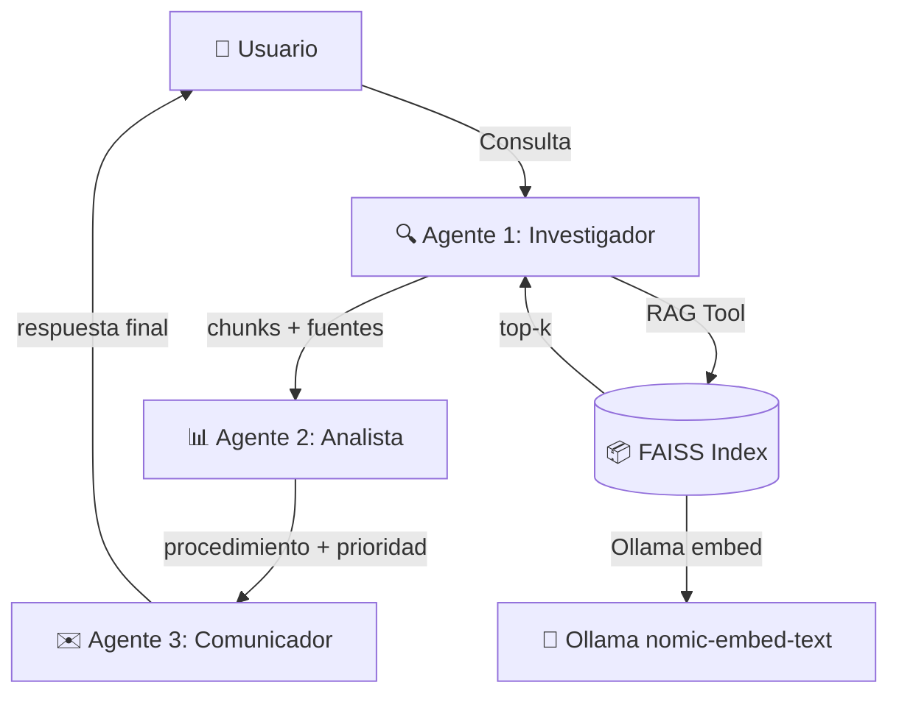

# EP2 - IT Assist: Multi-Agent Orchestration

**Orquestación Multi-Agente con CrewAI sobre Base RAG de EP1**

Caso de uso: Soporte de TI (contraseñas, VPN, correo, software, tickets).
Reutiliza el índice FAISS + chunks de EP1 sin reconstruir.

---

## 📐 Arquitectura Multi-Agente



### Roles de los 3 Agentes

| Agente | Rol | Tools | Entrada | Salida |
|--------|-----|-------|---------|--------|
| **Investigador** | Busca en base vectorial | `buscar_base_conocimiento_it` | Consulta del usuario | Fragmentos con fuentes |
| **Analista** | Sintetiza resolución | `clasificar_prioridad_ticket` | Fragmentos del Investigador | Procedimiento, prioridad, pasos |
| **Comunicador** | Redacta respuesta | (sin tools) | Análisis del Analista | Respuesta final al usuario |

### Procesos Implementados

| Proceso | Descripción | Notebook |
|---------|-------------|--------|
| **Sequential** | Orden fijo A→B→C, contexto encadenado | `1-multiagent_sequential.ipynb` |
| **Hierarchical** | Manager LLM decide delegación y calidad | `2-multiagent_hierarchical.ipynb` |
| **Memory Demo** | Short-term + Long-term (con/sin memoria) | `3-memory_short_long.ipynb` |

---

## 🏗️ Stack Tecnológico

| Componente | Tecnología | Propósito |
|------------|-----------|-----------|
| Orquestación | **CrewAI** (v0.80+) | Agentes, tareas, procesos |
| LLM | **Ollama local** (llama3.2:3b / qwen3.8:27b) | Generación y razonamiento |
| Embeddings | **Ollama** (nomic-embed-text) | Vectorización de consultas |
| Vector Store | **FAISS** (EP1) | Búsqueda semántica top-k |
| UI | **Streamlit** | App interactiva con tabs |
| Entorno | Python 3.11, Windows | Ejecución local |

---

## 📁 Estructura del Proyecto

```
evaluacion_2/
└── IT_Assist_MultiAgent/
    ├── app_multiagent.py               # Streamlit app (3 tabs + selector)
    ├── rag_tool.py                     # Tool RAG (FAISS + Ollama)
    ├── 1-multiagent_sequential.ipynb   # Notebook del pipeline secuencial
    ├── 2-multiagent_hierarchical.ipynb # Notebook del pipeline jerárquico
    ├── 3-memory_short_long.ipynb       # Notebook de la demo de memoria
    ├── IT_Assist_MultiAgent.ipynb      # Notebook explicativo
    ├── README.md                       # Este archivo
    ├── referencias.md                  # Referencias APA
    ├── requirements.txt                # Dependencias Python
    ├── preguntas_prueba.csv            # 12 preguntas de testeo
    ├── FUENTES_EXTERNAS.md             # Fuentes externas citadas
    ├── metadata_documentos.csv         # Metadata EP1
    ├── documentos/
    │   ├── internos/                   # 5 PDFs corporativos
    │   └── externos/                   # 2 PDFs (CISA, Microsoft)
    └── vectorstore/
        ├── it_assist.index             # Índice FAISS (768 dims)
        └── chunks.json                 # Textos + metadata
```

---

## 🚀 Cómo Ejecutar

### Prerrequisitos
1. **Ollama** instalado y corriendo (para embeddings y modelos locales):
   ```bash
   ollama pull llama3.2:3b        # rápido (~10s por pipeline)
   ollama pull qwen3.8:27b        # calidad (~90s por pipeline)
   ollama pull nomic-embed-text
   ollama serve
   ```
2. **Variables de entorno** en `.env` (puedes copiar `.env.example`):
   ```
   LLM_PROVIDER=ollama
   LLM_BASE_URL=http://localhost:11434/v1
   LLM_MODEL=llama3.2:3b
   LLM_API_KEY=ollama
   OLLAMA_BASE_URL=http://localhost:11434
   EMBED_MODEL=nomic-embed-text
   LLM_TIMEOUT_SECONDS=45
   LLM_MAX_TOKENS=700
   RAG_TIMEOUT_SECONDS=15
   GEMINI_API_KEY=tu_clave_de_google_rotada
   ```
   `GEMINI_API_KEY` solo es necesaria al seleccionar `gemini-2.5-flash`.
   No guardes claves reales en el repositorio ni las pegues en chats; si una
   clave se expone, revócala y genera otra en Google Cloud.
   Los límites de tiempo y tokens evitan que una consulta quede bloqueada
   indefinidamente; si se supera el timeout, la aplicación muestra el error y
   permite reintentar.
3. **Dependencias Python**:
   ```bash
   pip install -r requirements.txt
   ```

### Ejecutar Streamlit App

```bash
streamlit run app_multiagent.py
```
Abre `http://localhost:8501` en el navegador.

En la barra lateral de la aplicación, **Modelo LLM** permite elegir entre
`llama3.2:3b`, `qwen3.8:27b` y `gemini-2.5-flash`. Los dos primeros se
ejecutan en Ollama y Gemini usa la API de Google mediante `GEMINI_API_KEY`.
**Pipeline de orquestación** permite
elegir entre **Secuencial** (orden fijo Investigador → Analista → Comunicador)
y **Jerárquico** (un Manager de CrewAI coordina y evalúa la delegación).

En la pestaña **Consultas**, las preguntas de ejemplo cargan correctamente el
campo de entrada y el historial conserva hasta 20 consultas en
`memoria_larga.json`, por lo que se recupera al recargar la página.

La sidebar también permite activar o desactivar la **memoria persistente**.
Cuando está activa, las últimas interacciones se leen desde
`memoria_larga.json` y se entregan como contexto al pipeline; las nuevas
respuestas se guardan automáticamente. Si se desactiva, el historial sigue
guardándose para consulta visual, pero no se entrega como contexto al agente.
El botón de limpieza elimina ese archivo local.

La pestaña **Testeo** también conserva un historial de hasta 10 ejecuciones de
la batería de preguntas, mostrando fecha, pipeline, cantidad de respuestas
exitosas, errores, duración total y el detalle de las preguntas procesadas.
Además muestra un resumen estadístico con tasa de éxito y tiempo promedio.
En cada ejecución se puede seleccionar uno o ambos pipelines y uno o ambos
modelos locales y `gemini-2.5-flash`; la tabla compara preguntas, éxitos,
tasa de éxito y tiempo promedio por combinación. Así puedes medir, por ejemplo,
Secuencial + Ollama frente a Jerárquico + Gemini en las mismas preguntas.
En la batería, todos los modelos aparecen seleccionados por defecto. El
resultado incluye una tabla por combinación pipeline-modelo y otra agrupada
solo por modelo para facilitar el cuadro comparativo.
También puedes elegir ejecutar 1, 3, 6 o 12 preguntas por combinación.
La aplicación indica el estado de conexión con Ollama, permite iniciar una
nueva consulta, visualizar la prioridad detectada y descargar el historial
individual en CSV.

### Ejecutar notebooks

Abre cualquiera de los notebooks en VS Code o Jupyter y ejecuta sus celdas
con el entorno virtual del proyecto:

```bash
jupyter notebook
```

Los notebooks requieren Ollama activo y muestran el flujo completo de cada
demo. `IT_Assist_MultiAgent.ipynb` es el notebook explicativo general.

Cada notebook está organizado como documentación técnica ejecutable:

1. objetivo e indicadores demostrados;
2. configuración y arquitectura;
3. agentes, herramientas y tareas;
4. ejecución y evidencias;
5. validación, métricas y análisis;
6. conclusiones y limitaciones.

Esta estructura facilita revisar el diseño, preparar la presentación y
relacionar cada evidencia con la pauta de evaluación.
---

## ⚡ Rendimiento

| Modelo | Tiempo por pipeline (3 agentes) | Uso recomendado |
|--------|--------------------------------|-----------------|
| `llama3.2:3b` | **~8-15s** | Desarrollo, testeo, uso diario |
| `qwen3.8:27b` | **~90-120s** | Producción, máxima calidad |

> **Consejo**: Para evaluaciones y demos, usa `llama3.2:3b`. Para respuestas
> de máxima calidad, cambia a `qwen3.8:27b` desde la sidebar de la app.

---

---

## 📊 Comparación Sequential vs Hierarchical

| Criterio | Sequential | Hierarchical |
|----------|-----------|--------------|
| Orden | Fijo (A→B→C) | Dinámico (manager decide) |
| Evaluación | Ninguna intermedia | Manager evalúa cada output |
| Re-delegación | No | Sí (si calidad es baja) |
| Costo LLM | 3 llamadas | 3 + manager (4+) |
| Caso ideal | Flujo lineal claro | Consultas complejas/ambiguas |

---

## 🧠 Demo de Memoria

| Tipo | Descripción | Implementación |
|------|-------------|----------------|
| **Short-term** | Contexto entre agentes en una ejecución | `context=[t_inv]` en Task |
| **Long-term** | Persistencia entre ejecuciones | `memory=True` + JSON local |

El notebook `3-memory_short_long.ipynb` ejecuta 3 consultas comparando
con/sin memoria. La memoria persistente se escribe en `memoria_larga.json`
cuando se ejecuta la demo; este archivo es un artefacto local y no debe
versionarse.

---

## 🧹 Archivos retirados

Los tres scripts Python de demostración fueron retirados porque su contenido
se conserva en notebooks equivalentes y la aplicación Streamlit contiene el
flujo ejecutable para usuarios finales. Se mantienen únicamente:

- `app_multiagent.py`: interfaz y selección de pipeline.
- `rag_tool.py`: recuperación RAG compartida.
- Los cuatro notebooks: demos reproducibles.

## 🔧 Posibles mejoras

1. **Separar la lógica de agentes** en módulos reutilizables (`agents/`,
   `pipelines/`) para evitar duplicación entre la app y los notebooks.
2. **Agregar pruebas automatizadas** para RAG, validación de respuestas,
   clasificación de prioridad y selección de pipeline, usando mocks para
   Ollama y CrewAI.
3. **Configurar `Top-K` y el umbral RAG de forma efectiva** desde la app,
   pasando esos valores al motor en cada búsqueda en lugar de depender solo
   de variables de entorno cargadas al importar.
4. **Persistir la memoria en una ubicación configurable**, con limpieza,
   límite de tamaño y exclusión explícita desde Git.
5. **Agregar manejo de salud de dependencias**: comprobar Ollama, modelos,
   FAISS y archivos del vectorstore antes de ejecutar un pipeline.
6. **Mejorar observabilidad** con un identificador por consulta, tiempos
   por tarea y exportación estructurada de trazas.
7. **Fijar versiones reproducibles** mediante un lockfile y documentar una
   matriz de compatibilidad de Python, CrewAI y Ollama.

## 📈 Evolución EP1 → EP2

| Aspecto | EP1 (RAG) | EP2 (Multi-Agent) |
|---------|-----------|-------------------|
| Arquitecura | 1 LLM + RAG | 3 Agentes + RAG |
| Orquestación | Script Python | CrewAI (Sequential/Hierarchical) |
| Trazabilidad | Manual | Automática por agente |
| Memoria | No | Short-term + Long-term |
| UI | Streamlit (básica) | Streamlit (3 tabs + testeo) |
| Base de datos | FAISS (EP1) | FAISS (reutilizada) |

---

## 📚 Referencias

Ver [referencias.md](referencias.md) para citas APA completas.
